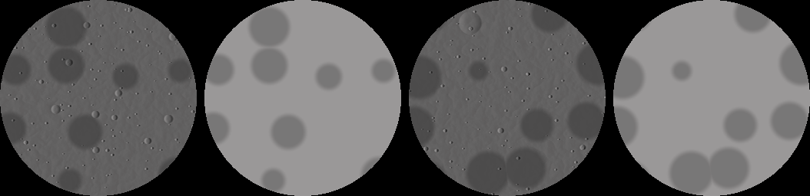
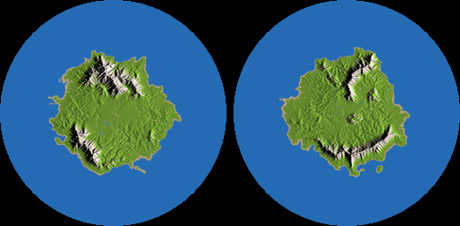

# The moon as a real bifacial world (and grids with their own frames)

**Status:** proposal, written 2026-11-12 (WORK_QUEUE item 27). Slices **M-1 built** (the grids'
data, the moon's generator, the far-body bake, the moon spawn search; native, not wired into the
game), **M-3 built** (the `GridFrame` abstraction, §2.1), **M-4 built** (the celestial model, §6), **M-2 built**
(the sky draws the moon from both: its baked face A lit by the real sun, today's size and halo × the lit share;
baked at the join on the main thread, not cached yet) and **M-6's bake built** (the home world's far-body bake,
§5: logic and tests, not drawn yet) and **M-7 partial** (travel natively: spaces per grid, capture and
release, gravity per grid, far flight; §7.1) and **M-7b's server and wire built** (the server holds the
moon's space, carries players across, streams and saves its chunks per grid, the `grid.frames` wire;
§7.2) and **M-7c built** (the client's predictor carries its player across grids as the server does, and
the game client follows it: the moon's chunks in the moon's frame, its sun, ⅙ g; the client says `grid.frames`;
§7.3; the browser flight a local check). Not architecture until an ADR adopts it; open questions in §12.

## 1. Brief and the owner's answers (2026-11-12)

> "We're going to make the moon a real bifacial world like the current world, with simple gray dirt
> across the whole thing for now. Farthest LOD, AKA the one you can see now, should be a simple
> lighting normal map based on the actual terrain. It should glow like it is now and cast light like
> it does now, and it should be the same size in the sky as it is now."

Answers: travel and landing later, **but design for it now** (the moon's terrain is the one you'd
stand on); about **¼ of our disc** (~12.5 km radius); terrain from the **world's seed** with moon
rules (cratered plains, ridges, maria), **gray dirt everywhere** for now, so every world has its own
moon; today's size in the sky, glow and moonlight kept; the face shown follows its orbit.

Further lines the same day, each folded in below:

1. "This moon is potentially an extension of our "other" buildable surfaces that aren't always
   oriented the same way like our physics objects." → §2: the moon is one **grid** with its own
   frame, as a built body is; the home world is the grid at rest.
2. "Could we make it so you can fly to the moon, when you get close enough you begin following its
   position, locked to it, gravity shifts to align like the underside of the bifacial world. Gravity
   is lower on the moon." → §7.
3. "The earth should use the same normal map kinda technique when far enough away, when on the
   moon." → §5: one far-body renderer and one bake for every grid.
4. "Add a moon starting spawn too side A and B." → §8.
5. "We may need to consider a new model for the sun, world, and moon positions in order to get moon
   phases." → §6, which **supersedes "today's motion"** for the moon.

## 2. Grids: one frame abstraction for the home world, the moon and bodies

A **grid** is a voxel lattice with its own **frame**: a position, an orientation, its own up and
gravity. Everything that crosses from world space into a grid goes through the grid's frame, as
face-local code crosses into the world through `dwell_world::FaceFrame` today.

```
world (the home grid's rest frame, f64)
 ├─ grid "dwell:home"   frame = identity (at rest)       faces A/B: FaceFrame
 ├─ grid "dwell:moon"   frame = orbit(t)  (§6)           faces A/B: FaceFrame
 └─ body #17 (a felled trunk, a build-platform raft)  frame = Rapier pose   (one face, +y)
```

**`GridFrame`** (proposed, M-3): `{ grid: GridId, origin: DVec3, rotation: DQuat, velocity,
spin }`, with `to_grid(point)`, `to_world(point)`, `vector`, `look`, and the grid's **gravity**
(`gravityScale` × g toward its midplane, by the face the point is on). Code that today takes a
`FaceFrame` takes `(GridFrame, FaceFrame)`: the grid frame turns world into the grid's space, the
face frame turns that into face-local. The home grid's frame is the identity, so every caller keeps
its results exactly (a test pins that the identity frame changes no bit).

| Needed for a grid | Built bodies have it (BUILT_BODIES.md) | New for a huge generated grid |
|---|---|---|
| Rendering | meshing per body (`pieces.rs` `piece_meshes`), drawn at its pose | chunk meshes in the grid's space drawn under its frame's model matrix; **LOD per grid** (the LOD tree is per grid, in its own coordinates); camera-relative drawing at 600 km |
| Collision | a collider per cell, in body space (Rapier) | chunk colliders in grid space; the controller runs **in the grid's frame** (the grid moves, the player stands still in it) |
| Targeting | the ray turned into body space (`Target::Body`) | the same, against the grid's chunks: `Target::Voxel { grid, cell, face }` |
| Edits | `BodyEditRequest` by body id | block edits carry a grid id (the home grid's is implicit, so today's message is unchanged) |
| Streaming | a body's cells all sent at once | **chunks streamed per grid**, keyed `(grid, chunk)`; storage per grid (a region file set per grid) |
| Gravity | none of their own | gravity toward the grid's midplane, by face (§7) |
| Seed and terrain | none | the grid's generator (`grids.json`), its seed from the world's |

### 2.1 `GridFrame` as built [M-3, 2026-11-12]

`dwell_world::GridFrame` (`crates/dwell-world/src/grid.rs`): `{ origin: [f64; 3], rotation: [x, y, z,
w], velocity, spin, gravity_scale }`, no grid id yet (the id is `grids.json`'s name; it joins the
frame where a frame is looked up by grid, M-7). Its maps:

| Map | What |
|---|---|
| `to_grid` / `to_world`, `vector_to_grid` / `vector_to_world` (`_f32`) | world ↔ grid points and directions |
| `face_at(p)`, `to_local(f, p)` / `from_local`, `vector_to_local` / `vector_from_local` | world ↔ grid ↔ face-local: the face is the side of the grid's midplane, then `FaceFrame` |
| `up(f)`, `look(f, yaw, pitch)`, `gravity(p, g)` | a face's up, a face-local look and gravity (toward the grid's midplane from the point's face, × `gravity_scale`) in the world |
| `cell_of(p)`, `cell_min(c)`, `cell_centre(c)` | the grid cell of a world point; a cell's corner and centre in the world |
| `point_velocity(p)`, `capture(p, v)` / `release` | the grid's velocity at a point; a point and velocity into and out of a moving grid (§7's p′, v′) |

`GridFrame::HOME` is the identity and returns its input bit for bit (negative zeros too). The
rotation is glam's `DQuat * DVec3`, term for term, so a body's pose as a frame (`dwell-physics`
`frame::grid_of_pose`, the `GridMaps` trait in the physics' types) maps to the same bits as glam.

**Through it now** (straight swaps, same bits): the client's ray into a body (`pieces.rs`
`raycast`), a felled piece's hits on players and its snap to the grid (`felling.rs` `hits`,
`follow_pose`, `resample`), the home world's targeting (`edit::raycast_block_in` with `HOME`, from
`dwell-game` `target_hit`), the controller's face at spawn and the predictor's stand-in frames
(`HOME.face_at`). **Left for later** (a note, not a rewrite): the renderer draws a body by its
(offset, quaternion) pair and home chunks unrotated: a model matrix per grid arrives with the LOD
per grid (M-5); the bodies' other rotations (`settle_glide`, the impact code) compose quaternions,
not points, and stay glam; colliders, streaming and storage per grid and the grid id on the wire
are M-7.

**The scan rule.** The both-faces check (BIFACIAL_WORLD.md §11.2) gains rule 3: a world point turned
into a grid's space by hand (`inverse * (p − origin)`) outside `grid.rs` fails unless marked
`// grid-boundary: <reason>`.

**Tests.** `dwell-world` `grid.rs` (unit, both faces where face-dependent): the home frame bit for
bit and equal to `FaceFrame` on each face; 200 moving, turned grids out to 600 km with points,
vectors, cells and capture/release round-tripping (≤ 1 µm), lengths kept; a carried point has no
velocity in its grid; gravity toward the grid's midplane at ⅙ g on each face; a quarter turn's cells.
`dwell-world` `tests/grid_frame.rs`: `raycast_block_in` on `HOME` equals `raycast_block` on both
faces; on a turned grid 250 km out a world ray finds the grid ray's cell at the same distance.
`dwell-physics` `tests/grid_frame.rs`: a body's pose as a frame matches glam to the bit (2000
poses); the home frame picks the controller frame of the height. The physics, sim (felling) and
game suites are unchanged, on face B too (`DWELL_FACE=b`).

So the first slices don't paint the work into a home-only corner: the data is a **list of grids**
from M-1, the generator and the bake are keyed by grid, and the frame comes before travel (M-3).

## 3. The data: `shared/worldgen/grids.json` [built, M-1]

One entry per grid (validated in `crates/dwell-worldgen/src/grids.rs` with messages; a grid added
by data alone generates, a test does it):

| Field | Home | Moon | Meaning |
|---|---|---|---|
| `name` | `dwell:home` | `dwell:moon` | namespaced |
| `frame` | `rest` | `orbit` | where it sits: at rest, or on the moon's orbit (§6) |
| `radiusM` | `world` | 12500 | the disc's radius; `world` = the world's own size (BIG_MAP.md) |
| `seedSalt` | — | a u32 | mixed into the world seed: every world its own moon; required for a moving grid, unique |
| `gravityScale` | 1 | 0.1667 | its surface gravity × the home world's |
| `captureM` | — | 40000 | inside this distance of its centre a flying player is captured (§7) |
| `farM` | 400000 | 150000 | past this the grid is drawn as a far body (§5) |
| `generator.kind` | `terrain` | `cratered` | today's generator, or the moon rules (§4) |

Both faces of every grid: face A from the grid seed, face B from `bifacial::face_seed`, as home.

## 4. The moon's generator: `cratered` [built, M-1]

`CrateredTerrain` (`grids.rs`), face-local heights (m over the grid's midplane), all from data:

- **Datum and plains:** `datumM` (72) + fbm plains (`plains`, ±5 m, 700 m).
- **Ridges:** ridged noise (`1 − |fbm|`)^`sharpness`, 12 m over 2.4 km; × `inMaria` (0.35) in maria.
- **Maria:** basins on a jittered grid (`cellM` 7 km, `chance`, radius 1.6–3.4 km) with a soft
  `edgeM`; inside, the floor sits `depthM` lower, the plains are `flatten`ed, only `craterDensity`
  of the craters are kept (a younger floor), and the ground is `maria.block`, `dwell:moon_mare_dust`
  (a darker dust; owner, §12 Q1): a column at least half in a mare takes it.
- **Crater field:** size classes, each `perKm2` craters a km² with radii in `radiusM` (u² toward the
  small end): a jittered grid of cell √(10⁶ / perKm2), one crater a cell, so density is the data
  exactly. A crater of radius R: a flat floor `depthRatio`·R deep (≤ `maxDepthM`) over
  `floorFraction` of R, a parabolic bowl to a rim `rimRatio`·R high (≤ `maxRimM`), ejecta falling as
  the cube of the distance out to `reach`·R. Craters add; the ground never goes under `minM` (16 m).
- **Blocks:** `dwell:moon_dust` on the highlands and `dwell:moon_mare_dust` in the maria (gray and
  darker gray, both dig like sand; palette ramps `regolith` and `mare_regolith`, painterly tiles
  `moonDust` and `moonMareDust`; prototype content, ARCHITECTURE.md §6.1).
- **Chunks:** `CrateredTerrain::generate(coord, chunk)` fills a grid chunk through `FaceFrame` (face
  B's flipped), so travel streams the same terrain the sky shows (§7).

Tests (`crates/dwell-worldgen/tests/grids.rs`, both faces): floors under rims and rims raised over
the ejecta's reach; 4 × `perKm2` gives 4 × the craters; maria flatter (mean slope < 0.7 × the
highlands') and lower; heights inside the build volume and over `minM`; chunks hold dust up to the
height.

## 5. One far-body renderer for every grid

**The bake [built, M-1].** `grids::bake_far(src: &impl FarSource, face, size) -> FarBake`, generic
over a grid's generator (`FarSource`: radius, height at a texel's scale, albedo). Per face, `size`²
texels over the disc's square, face-local:

- `normal_height` RGBA: the normal (R = x, G = z, B = up), A the height over `height_range`; outside
  the disc straight up with A 0. Heights at texel centres with only the craters at least a texel
  wide (smaller ones would only alias), normals by central differences.
- `albedo` RGBA: the ground blocks' own colours (blocks.json `color`): the highland block's, the
  maria's darker block's, blended across a mare's soft edge by its weight; no separate albedo
  constant. The mare block's colour is 0.55 × the moon dust's luma, the old sky moon's seas (its
  shader's `1 − moon.maria`). A 255 inside the disc.

Deterministic per (world seed, grid, face); different seeds and faces differ; on a crater's inner
wall the normal leans toward its centre (tests). 256² per face (the data's `bake.size`): **95–160 ms
natively per face, 512 KiB per face** (both maps), 2 MiB for both faces of the moon. Preview,
seed 0 (face A lit by a low sun, its albedo, face B lit, its albedo; `cargo run --release -p
dwell-worldgen --example moon_bake -- 0 <dir>`):



**The renderer (M-2).** A grid farther than its `farM` from the camera is drawn as a **far body**:
a disc quad in the grid's frame (its two faces back to back, `FaceFrame` choosing which one the
viewer sees by the side of its midplane it is on), sampling the face's normal and albedo maps, lit
by the **real sun direction** turned into the grid's frame (§6), plus today's glow and bloom from
`daynight.json`'s `moon` (scaled by the lit share seen). Owner, 2026-11-12: **"If not already planned
we want the same moon shine/glow effects we already had. So the moon should look bright."** So the
drawn moon keeps today's halo and brightness: its lit part is as bright as today's moon (`moon.color`;
the bake shapes the surface, not its overall brightness), and its bloom and glow are today's × the lit
share (M-4's `Celestial::glow`, `MoonView::lit`). Nearer than `farM` the grid is LOD terrain
(its own LOD tree, M-5), crossfading over a band. The bake is cached per world (the client's world
store, keyed by grid, face, generator version and seed), baked in a worker on the first join.

**The home world's bake [built, M-6, 2026-11-12; not drawn yet].** The same `FarSource` and
`bake_far` over the home world (`dwell-worldgen` `home_far.rs`, `HomeFar::new(&BifacialTerrain)`),
from what the world already holds at join (each face's world map and generator; no chunk is made):

- **Height:** the world map's eroded cell heights (100 m cells over the 50 km disc), box-filtered
  over the texel at the cells' spacing (4 × 4 cells a 390 m texel), water standing at its level
  (the sea's, a lake's), so seas and lakes bake flat; normals by the shared central differences.
- **Albedo:** the block the coarse column at the texel's centre shows from afar
  (`TerrainGenerator::far_surface`: its biome's palette for its band) by the block's `color`
  (blocks.json). No new colour table: the biomes' palettes are the data. Under water it is the bed.
- **Water:** a separate channel, `FarBake::water` (one byte a texel: the share of its cells in the
  map's sea or a lake; rivers are narrower than a texel), for the sea's colour, glint and
  reflection. `FarSource::far_water` defaults to none, so the moon's bake has an all-0 channel.
- **Size as data:** `grids.json` `dwell:home` `generator.bake.size` (256, validated like the
  moon's): **256² a face, 576 KiB a face** (normal/height + albedo RGBA + water), 1.1 MiB both faces;
  **~0.17 s a face natively** (release; the coarse columns for the albedo are most of it, a 2 × 2
  sub-grid doubled it). The owner's brief chose 256²; 512² (a texel a pixel from the moon at 1080p) is
  one number in data, 4× the memory and time.
- Clouds are out of scope.

Tests (`crates/dwell-worldgen/tests/home_far.rs`, both faces): deterministic per seed, different
between seeds and faces; each texel's water byte the share of its cells in the map's sea or lakes,
whole-sea texels 255, outside the disc 0, the bake's wet share the map's (±2%); steep mountain texels'
normals lean downhill (≥ 95%, against the map's slope over two texels), open sea straight up; every
colour a block's, several of them; the moon's bake dry; the data's size, 576 KiB and under 3 s
(debug test build); a bad home `bake.size` fails with a message. Preview, seed 0 (face A and face B
lit by a low sun from +x, water in the water block's colour; `cargo run --release -p dwell-worldgen
--example home_bake -- 0 <dir>` writes each face's lit, albedo and water PNGs and this sheet):



Drawing it from the moon (a far body in the sky of a player standing on the moon) comes with the LOD
per grid and travel (M-5, M-7); the client bakes it in its world-map worker and caches it per world,
keyed like the moon's. From the moon (~597 km) the home disc is ~4.8° in radius (four times the moon's
look from home).

## 6. A celestial model: sun, home and moon as bodies [built, M-4; not drawn yet]

**As built (M-4)** (`dwell-look` `celestial.rs`, DAY_NIGHT.md §14): the orbit is data in
`shared/look/daynight.json` — the month is `moon.cycleDays` (8, new to new) from `moon.startPhase` or
the world's phase; `moonOrbit` holds `inclinationDeg` 5, `nodeDeg` 90 and `nodeTurnDays` 96 (the
node turns against the sun, so eclipse seasons come round), `distanceM` 596 800 (checked by
`daynight.mjs` to keep grids.json's 12.5 km at `moon.radiusDeg`); `moon.nightFloor` 0.15. The
`Celestial` model gives, from the world clock: `sun_direction` (today's, golden-tested),
`moon_position`/`moon_direction` (from the home disc's centre), `moon_axes` (tidally locked: the
grid's up at home; M-3's grid frame), `view(t, viewer)` (the face seen, the lit share n·s, the phase,
the direction), `moonlight(t, viewer, face)` (the floor + the rest × lit × the disc over the
horizon) and `glow` (today's halo × lit). The world's month start is the optional `WorldSettings`
tag `MOON_PHASE` (0x84); absent, the data's. The moon's orbit is placed in the sky frame (turning
with the sun, as the stars do), so the phase runs evenly though the solar angle doesn't; with an
integer month the full moon comes at the same clock time (face A's midnight for `startPhase` 0.5).
New worlds don't draw their phase from the seed yet (none writes the tag): M-2's choice.

**Orbits by seed** (design, 2026-11-12; [REALISTIC_WORLD.md](./REALISTIC_WORLD.md) §8, owner: "Orbits should
be seed determined."): the same model takes a seed-rolled orbit stored as world settings (a `CELESTIAL` tag
beside `CLOCK` and `MOON_PHASE`): the sun path's pole height (the disc's latitude: today's 60° noon is 30° N on
face A, 30° S on face B), its yaw (north), the distance from the sun, an axial tilt and year (seasons, later),
and the moon's month, inclination, node and phase, its distance kept so its size in the sky stays. The
Realistic climate (R3) reads the latitude from it instead of a picked band; the default and starter worlds
roll nothing and keep today's sky exactly.

The design as proposed:

Today (DAY_NIGHT.md §3) the home disc is fixed, the **sun** circles it on a great circle tilted so
it culminates 60° above face A's horizon, and since the circle passes under the disc, **face B gets
day while face A has night** (face B's solar angle is A's + 180°). The **moon** is drawn opposite the
sun with a phase counted by the clock (8 days), not by geometry.

Proposed: positions as data (`shared/look/sky_bodies.json`, or an `orbit` block in `grids.json`):

```
            ☉ sun: a direction s(t), today's path (period 1 day, 60° culmination, dayS/nightS split)
            :
   moon ◐ ··:·· orbit: radius D, inclination i to the sun's path plane, sidereal period P
     \      :
      \  ___:___  home disc (at rest), face A up, face B down
         ‾‾‾‾‾‾‾
```

| Body | Model | Today kept |
|---|---|---|
| Sun | the direction `s(t)` exactly as today (the uneven solar angle keeps 20/10-minute days) | the clock, the path, both faces' day and night |
| Home | at rest at the origin (the frame everything is placed in) | — |
| Moon | at `D · o(t)` on a circle of radius D, inclined `i` to the sun's path plane, period P sidereal days; orientation tidally locked (§12 Q2) | its angular radius 1.2° → **D = 12.5 km / tan 1.2° ≈ 597 km**; its glow and bloom |

- **Phases fall out of geometry**: the far-body renderer lights the baked normals by the real sun
  direction in the moon's frame. The synodic month S follows from P: 1/S = 1 − 1/P, so the
  8.25-day month (§12 Q5) is P = 8.25/7.25 days; the moon rises ~2.5 minutes of a 20-minute day later each day, is up
  by day near first and last quarter, and new moons are moonless nights.
- **A flat disc has no terminator**: a sunlit face brightens and dims as a whole (n·s), so a crescent
  is a dim face whose crater walls catch the light, not a lit sliver. For the familiar crescent the
  renderer can mix a **dome normal** into the baked one (a data knob, `domeBias` 0–1; §12 Q3).
- **Moonlight on the ground** = today's `moonLight` × the moon's lit share seen from the home grid
  (the sunlit side's n·s, where the viewer sees that side) × its height over each face's horizon (as
  today, per face), down to `newMoonLight` if the owner wants every night readable (§12 Q4).
- **Face B:** it sees the moon when the moon is under the home midplane, and sees the moon's other
  side lit or dark by the same geometry; nothing face-specific beyond `FaceFrame`.
- **Travel uses the same positions:** the moon's world position and orientation at tick t are this
  model's `D · o(t)` and spin, the `orbit` frame of `grids.json`; the server and the clients compute it
  from the world clock, so they agree with no new message.
- **Compatibility:** the clock is already the world's (`WorldSettings`, ADR 0054). Propose the
  **orbit (P, i, phase at tick 0) as an optional world setting**, its phase drawn from the world seed
  so every world's month starts somewhere else; an older world without it takes the build's default.
  The sky change alone is a look (not public API, not breaking); once players can stand on the moon,
  its position at a tick is public API on the line (a player saved on the moon must find it there).

## 7. Travel: fly there, be captured, land

- **Distance and speed.** The moon is ~597 km out (§6). Flight today tops out at 8 m/s × 2.5 × 2^5.5
  ≈ 905 m/s (`flySpeedMaxLevel` 11), **~11 minutes** each way. Proposed **far flight**: past a
  height of 2 km over every grid's surface, the fly speed grows with the distance to the nearest grid
  (v = clamp(k · d, today's, 20 km/s), k ≈ 0.08/s), so 597 km takes ~1–1.5 minutes and slows
  smoothly toward either surface (data in `shared/physics`, the controller's fly mode).
- **Capture.** Inside a grid's `captureM` (40 km for the moon, past its radius) the server switches
  the player's **frame** to the grid's: position and velocity turned into the grid's space
  (p' = R⁻¹(p − c(t)), v' = R⁻¹(v − ċ(t) − ω × (p − c))), so nothing jumps; from then on the player
  moves with the grid, locked to its position and orientation. Leaving past `captureM` × 1.1
  (hysteresis) hands them back to the home frame the same way.
- **Gravity** turns to the grid's local down like crossing the home midplane today
  (BIFACIAL_WORLD.md §6): the face sign is the side of the moon's midplane the player is on, the view
  keeps its world direction and rolls upright over `crossingRollS`; its strength is the grid's
  `gravityScale` (⅙ on the moon: higher jumps, longer falls). Between the grids (in neither capture
  and over 2 km up) flight is the only mode: the home grid's gravity holds until the player is
  captured (§12 Q6).
- **Authority and protocol.** The server owns a player's frame; snapshots carry the player's **grid
  id** (a byte, optional tag), block edits and targets a grid id (the home grid's implicit). A client
  that does not know grids would draw a captured player wrongly, so the travel phase is a **new
  compatibility line** (the owner raises it); M-1 to M-4 are not.
- **Precision.** At 597 km an f32 is ~6 cm: everything is drawn camera-relative and simulated in the
  player's grid frame (f64 at the frame change), never in raw world f32.

### 7.1 Travel as built [M-7 partial, 2026-11-12]

`dwell-sim` `travel.rs`, native and tested, not yet held by the server's session loop:

- **A space per grid** (`GridSpace`): the grid's own `VoxelWorld` (chunks from its generator in its
  local frame, `grid_generator`: the moon's `CrateredTerrain::generate`, chunks off its slab air and
  never stored), its own `Physics` and `Players`. Positions in a space are grid-local, so the
  controller runs unchanged on every grid (down toward that grid's midplane by face, both faces
  through `FaceFrame`), with that grid's chunk colliders. A player in the moon's space is locked to it.
- **Frames** (`grid_frame_at`): home `GridFrame::HOME`; the moon at `Celestial::moon_position` with
  `moon_axes` (as a quaternion, `quat_of_axes`), its velocity and spin from the orbit (central
  differences; a grid point carried one tick lands within 1 cm of the next tick's frame).
- **Capture and release** (`Travel::update`, before each tick): a **flier** within `captureM` of a
  grid's centre (its midplane's centre) moves into its space: `release` from the old frame, `capture`
  into the new, at the same instant; its controller state (`Players::restore`), its face there
  (`Players::settle_face`, the vertical state mirrored as at a midplane crossing) and the grid's
  gravity go with it. Past `captureM × releaseFactor` (1.1) it goes back to home the same way.
- **Gravity per grid**: `Players::set_gravity_scale` (the grid's `gravityScale`): gravity × the
  scale everywhere the controller applies it, the jump's take-off speed kept, so a jump on the moon
  rises 6× as high and lasts 6× as long (`dwell-physics` `tests/grid_gravity.rs`; scale 1 the same
  bits).
- **Far flight**: `grids.json` `travel.farFlight` (`aboveM` 2000, `perS` 0.8, `maxMps` 30 000 since
  2026-11-13): past `aboveM` from every grid's slab (its disc, `surfaceM` each side of its midplane) the
  server sets `Players::set_far_fly_speed(min(perS × d, maxMps × space))`, which flight takes as its
  least speed; `space` is how far into space the flier is (`travel::space_at`: the atmosphere's thinning,
  the sky's value, at its height over home's face and its distance past home's rim). Owner, 2026-11-13:
  "If you can actually fly to the moon/sun, we need a much faster fly speed for creative. But only in
  space." So in home's air the speed is the slider's alone, in space up to 30 km/s, easing down toward
  every body's ground: the face A trip takes 36 s (was ~90 s). The client's `TravelMap` and the server's
  `Grids` read the same rules (`dwell-sim` `tests/grids.rs`
  `far_flight_is_space_speed_in_space_only_and_server_and_client_agree`, both faces); a fast arrival
  (closing over 5 km/s) is captured without a snap (`game_local`
  `the_moon_report_steers_a_flight_into_its_capture`).
- **The look across** (`look_across`): a face-local look continued onto another grid's face with the
  same world direction (for the client's view, then rolled upright as at a midplane crossing).
- **Tests** (`dwell-sim` `tests/travel.rs`): a scripted flight from 300 m over home to the moon's
  spawn on face A, and round its rim to face B, a landing, a ⅙ g jump (6× the config's height, ±5%),
  and back to home: one capture and one release, each keeping the world position (≤ 1 cm) and the
  world velocity (≤ 1 cm/s) at the switch's instant; the trip out takes 90 s to face A (110 s to
  face B, round the rim), the moon jump 7.44 m (6× home's). After a switch, flight steers relative
  to the new grid (its wish is a speed in that grid, which moves ~1.8 km/s), so the path turns over
  the next ticks as a change of heading does; the position never jumps.

### 7.2 The server and the wire [M-7b server + wire built, 2026-11-12; the client outstanding]

`dwell-sim` `server/grids.rs`:

- **The spaces.** `Grids` holds one `GridSlot` per grid of `grids.json` with a generator of its own
  (the moon): its `GridSpace` and the chunks edited since the last save. The home grid stays the
  server's own world, physics and players, so everything built on them is unchanged. Each tick the
  spaces holding a player step after the home physics.
- **Travel** (`Server::travel_players`, before the inputs): a home flier inside `captureM` is carried
  into the moon's space (`travel::carry`, shared with `Travel::transfer`: the world position and
  velocity through `release`/`capture`, the controller state, the face, the ⅙ g); an away player past
  `captureM × releaseFactor` back home. While away the session's home handle is `None` and `away`
  names its slot and handle; its inputs go to that space; the home view's streaming waits. Every
  player's far-flight speed is set from its world distance to the nearest slab (home's included).
- **The wire, behind `grid.frames`** (`shared/protocol/capabilities.json`; the server lists it):
  `PhysicsSnapshot` ends with a `GridView` (after the swing kinds, which are written whenever it is):
  a byte, the grid's index in `grids.json` (0 home), and off home the grid's frame at the tick (origin
  f64 × 3, rotation f64 × 4); `local` is then grid-local. `ChunkData` and `ChunkUnload` end with the
  grid's byte when not home (a trailing 0 is malformed: home is no byte). A client without the
  capability gets its world position and never a grid id or another grid's chunk.
- **Streaming per grid** (`stream_grid_chunks`): an away `grid.frames` client gets its grid's chunks
  round its grid-local position, nearest first (8 a tick; Air off the slab, Generated unedited for a
  client that generates, else the voxels), unloaded past the view; all of them unloaded on release.
- **Edits per grid**: an away player's `BlockEditRequest` is its grid's (the cell in the grid's own
  space), applied at once (a break clears the cell, a place sets the cell against `face`), acked in
  the edit numbering, the chunk sent whole to that grid's clients that have it.
- **Saved per grid**: the world file's optional `grid_chunks` table, (grid name, cx, cy, cz) →
  (revision, the chunk as the `chunks` table encodes it), additive (an older build on the line never
  opens it); put back into the grid's space when the server opens the world.
- **Tests:** `dwell-sim` `tests/grids.rs` (both faces): two players, this build's capabilities and
  an older client's, flown in over the capture sphere (no jump: ≤ 1 cm, ≤ 5 cm/s), landed and walking
  under ⅙ g, the moon's chunks to the new client only (the older one: no grid id, its world position),
  released home with no jump and the moon's chunks unloaded; a moon edit not touching the home cell
  of the same coordinates, saved in `grid_chunks` and there again on reopening. `dwell-protocol`
  `tests/grid_frames.rs`: the tails round-trip and are absent unless sent; `dwell-storage`: the table
  round-trips apart from home's chunks.

**Outstanding** (the client's side is M-7c, §7.3; these remain): the other systems for away players (items, vitals, creatures, water,
felling: they skip them), remotes drawn across grids (they are sent at their world positions), the
player's grid in its saved record (a player who leaves on the moon is saved at its world position),
the moon's unedited chunks never evicted, tier 1 bodies in the moon's space (none are made there yet).

### 7.3 The client across grids [M-7c built, 2026-11-13; the browser flight a local check]

- **The travel rules without the spaces** (`dwell-sim` `travel.rs` `TravelMap`): the grids the server
  builds (those with a generator of their own, by `grids.json` index), their frames from the clock, and
  capture, release and far flight as `Grids` runs them. A client builds it from what it knows at the
  join (the world seed, size and settings: `TravelMap::new`); the server hands out its own
  (`Grids::travel_map`), and a test checks the two hold the same grids.
- **The predictor in grid frames** (`dwell-physics` `predictor.rs`): a `GridTravel` hook
  (`Predictor::set_travel`; `TravelMap` implements it) runs before every predicted tick, replays
  included, at the world clock of the server tick the input runs in (`seq + server_tick − 1 − ack`,
  from the latest snapshot): a home flier inside `captureM` is carried into a fresh space of the moon
  (`controller::carry`, moved from `dwell-sim` so both use it: the state, the face, the ⅙ g), a player
  past `captureM × releaseFactor` back home, and the far-flight speed set. The predictor's positions are
  then its grid's (`Predictor::grid`); the remotes' and pieces' stand-ins are dropped on a carry (they
  were the old space's). Each history entry keeps its grid: a snapshot whose `GridView` names another
  grid than the entry at its ack counts a `grid_misses` and re-places the player in the server's grid
  (`regrid`) before the replay; a correction across grids snaps.
- **Tests:** `dwell-sim` `tests/grids.rs` `the_client_predicts_capture_and_release` (both faces):
  player 1's predictor beside the server, captured by flying 200 m over the moon's ground and released
  by flying out past × 1.1, each on the same input as the server's (`grid_misses` 0, no snap; red
  without the hook), and falling at ⅙ g toward the moon's midplane on that face. Its replays near the
  moon are the snapshot's f16 velocity at the moon's ~1 km/s orbital speed in home's frame (a cm or
  two at an ack), not the crossings.
- **The game client follows its grid** (`dwell-client` `game.rs`, behind `grid.frames`): `Game::set_grid_frames`
  (the session's capability; the web app and the `game_local` rig call it) installs a `TravelMap` built from the
  world's seed, size and settings (`TravelMap::new`) as the predictor's hook and the game's own copy. The streamer
  holds **the chunks of one grid**, the predictor's (`Game::grid`): at a crossing (`follow_grid`, after a predicted
  tick or a snapshot's `regrid`) every chunk held is dropped (`ChunkStreamer::unload_all`) with the edit
  predictions, and `ChunkData`/`ChunkUnload` of another grid, and home's `VoxelModification` while away, are
  ignored. The look goes on with the same world direction onto the new grid's face (`look_across`; the face flip
  reset: no midplane roll). Positions are grid-local, so the view is drawn **in the grid's local frame**: the
  camera, the chunks and the collision in moon coordinates, its up the moon's face's.
- **The sky on the moon** (`grid_view.rs` `day_on_grid`): the sun, the moon's direction and the stars' axis
  turned into the grid's frame (`GridFrame::vector_to_grid`) at the clock's time, and the moon's far disc not drawn
  (`DayState::moon_shown`, the `DaySky` uniform's `space.w`, read by `dwell_moon` in `sky.wgsl`). Home's LOD (its
  sections and stand-ins) is hidden while away; the moon's own LOD is M-5.
- **The server's side for it:** the moon's chunks go to a `grid.frames` client always as voxels (or Air), never
  Generated (the client's workers generate home's terrain only), and at its capture the client's home stream is
  forgotten (`Session::forget_home_stream`: the sent and requested chunks, the centre), so on the release home
  streams again from nothing, as the client dropped it.
- **`grid.frames` is said:** `capabilities::CLIENT_PENDING` is empty.
- **Tests:** `dwell-client` `tests/game_local.rs` `a_scripted_flight_to_the_moon_and_back_follows_its_grid` (both
  faces, through `LocalCore`): placed 200 m over the moon's ground moving with it, flying: captured by the client
  and the server; the moon's chunk under its spawn requested and meshed, its cell the server's moon dust; the
  camera on the moon's face, no far moon disc; ⅙ g (±0.03); no grid miss at the capture; flown out past the release
  sphere: released by both with no snap or grid miss, the moon disc back; home's chunks stream again at the spawn.
  `dwell-client` `grid_view.rs` (both faces: the sun's rise over a turned grid's face kept), `dwell-look`
  `the_moons_disc_is_drawn_unless_the_viewer_is_on_it`, `dwell-protocol` (the client says `grid.frames`).
- **The browser flight's tool** (2026-11-13): `__dwell.moon()` (the moon's world position, the way and distance to it,
  the player's grid, the gravity) and the bench's `flyTo` step and `moon-trip` scenario (docs/DEV_TOOLS.md "The
  moon"): a dev move to just outside the capture sphere, a real flight in, the descent, the fall measured and a
  landing, then out past the release and home's chunks back; natively `game_local`
  `the_moon_report_steers_a_flight_into_its_capture` (both faces).
- **The first browser flight's fixes** (2026-11-13, BUGS.md #123–#126): off home every chunk held is drawn
  (`Game::chunk_fade` answers in full: the LOD's selection is home's, in home's coordinates); at each crossing home's
  LOD is dropped (`LodSystem::drop_all`: its section meshes off the view, the selection cleared; it builds again
  from the root back home), so the mesh memory doesn't grow per trip; home's clouds are not drawn off home
  (`DayState::clouds_shown`); and a correction just after a carry (for `CARRY_WINDOW` inputs) up to the grids'
  relative speed × `CARRY_SLIP_TICKS` ticks is smoothed, not snapped: the server runs an input a few ticks off the
  predictor's guess, and the carry then used the moon's frame at another moment of its ~1 km/s orbit (~17 m a
  tick). Tests (`game_local`, both faces): `on_the_moon_its_chunks_are_drawn_and_homes_lod_meshes_dropped` (LOD on:
  the moon's chunks under the player drawn, no home section held on the moon, home's LOD back after the release)
  and `a_moon_trip_on_a_jittery_device_makes_no_snap` (6 ticks of latency, a 4-tick frame every 7th: no snap
  through the capture, landing and release).
- **Teleporting onto the moon** (owner, 2026-11-13: "We should just teleport to the moon to see if ground draws"):
  `LocalCore::moon_land` puts the local player 1.5 m over the moon's spawn on a face, moving with it, inside the
  capture sphere, so the next tick captures it there; the drawing test and the bench's `moonLand` step and
  `moon-draw` scenario use it (DEV_TOOLS.md "The moon"). It found BUGS.md #136: the server, having captured first,
  streams the moon's chunks before the client crosses, each once; the game now holds another grid's `ChunkData`
  (`other_grid_chunks`) and feeds those of the grid it crosses into to the streamer.
- **The follow-ups after the first trips (2026-11-13, branch `claude/moon-m5`):**
  - **The moon's own sky** (BUGS.md #126; owner: "Sun and moon should be space, the same as night sky"): the sky is
    one layered model, space the base and day a layer of a grid's air (`grids.json` `atmosphere`; DAY_NIGHT.md
    §15): on the moon the sky is space at every hour, the stars out, the sun white, no fog.
  - **M-5, the moon up close** (`dwell-client` `grid_bodies.rs`): a grid with a `nearMesh` (`cells` 96 across,
    `sinkM` 8) is drawn nearer than its `farM` (150 km) as a coarse mesh of its real surface, both faces, from
    the same `FarSource` as its far bake (heights sampled at a quarter cell, each vertex the lowest over the
    cells round it less `sinkM`; colours its blocks'), at its pose in the drawn frame (`pose_in`: home's frame
    at home), the sky's far disc then hidden. On the moon the same mesh is drawn at the identity under the
    chunks, which cover it where they are; it shows where they are not yet, so nothing is swapped at the
    capture. Built on the main thread the first time it is shown (~0.3 s natively). Tests: the mesh a metre
    or more under the ground (99.5 %, never 4 m over), facing out, on both faces; the pose; `game_local`
    `the_moon_up_close_is_its_surface_mesh_then_under_its_chunks` (both faces). Deviations from §5's plan: a
    mesh, not the LOD tree per grid, and a switch at `farM`, not a crossfade (the disc and the mesh differ
    in shading at the switch).
  - **The roll upright at a crossing**: the view eases from the one drawn before upright onto the new face
    over `motion.json` `gridCrossingRollS` (0.6 s; BUGS.md #138).
  - **The maps on the moon**: hidden off home with a label ("No map on the moon", named by the grid): the
    simpler of the two (the moon's own map would need its generator in the map's workers and tile store).
  - **Faster flight in space**: far flight scaled by how far into space the flier is (§7.1), one system.
  - **Landing under the ground** (BUGS.md #139): the report's `groundM`, not the landing: it read the smooth
    height, not the cells' top.
- **The owner's three moon things and the sun's light (2026-11-13, 0.63.0, branch `claude/moon-fixes-3-l0zjdx`;
  BUGS.md #143–#145):**
  - **No moon in the moon's sky:** its halo, glint and moonlight are not packed there either (`DayState::on_moon`);
    the cratered disc the owner saw is most likely the sun (its disc shaded by the sun world's bake, white in space).
  - **Ramps on the moon:** `generator.ramps` (`notched`), home's rule as data (HALF_HEIGHT_GRID.md §10).
  - **The LOD per grid (BUGS.md #156, 2026-11-14):** the rings (two levels in effect, coloured by the far bake's
    albedo, not the blocks' looks) are replaced by a `LodSystem` per grid (`grids.json` `lod: true`; `dwell-client`
    `grid_lod.rs`): home's selection, levels and fades over the grid's disc, sections from the grid's generator in
    the job workers (`Job::GridLod`, a grid id; `dwell-worldgen` `grid_lod.rs`'s `GridColumns`), meshed and coloured
    as home's. Home's ties were answered: the sections come from a worker job naming the grid, a grid has no index
    (every section generated), and the tree's bounds are the grid's (`WorldBounds::grid`). Dropped and made again
    at each crossing. Tests: `dwell-worldgen/tests/grid_lod.rs`, `dwell-client/tests/grid_lod.rs` (both faces, moon
    and sun: graded levels to the horizon, no gaps or overlaps, tops in the block look, the High budget).
  - **Home from the moon (M-6's drawing):** home's `nearMesh` (64 cells) from its world maps (`HomeFar`, the
    shell's `far_terrain`), its seas in the water block's colour, drawn at home's place in the moon's frame at every
    distance (`skyDisc` false), lit by the sun turned into the moon's frame (so in its phase).
  - **A light rig per grid:** `light` (`grid_light.rs`): on the moon the sun and home's faint fill, on the sun
    home's and the moon's reflections and the lava's glow from below.
- **Not yet:** the browser checks (`moon-draw`, `moon-trip`, on a GPU, local); shadows from the rig's lights;
  the moon's ground light (its hemisphere light is home's, its sunlight follows home's keyframes); remote
  players on another grid (sent at world positions); the other systems for away players listed in §7.2.

## 8. Moon spawn, faces A and B [search built, M-1; the choice built, M-8, 2026-11-13]

`CrateredTerrain::spawn_point(face)`: a golden-angle spiral from the disc's centre to the first
column whose ground is flat (±1 m over 4 m) and clear of every crater ≥ 10 m wide (outside 1.2 radii),
deterministic per seed, one per face (tested on both). In M-8 the New world form's spawn choice and
the `?spawn=` link gain `moon` and `moon-b` (beside today's `b`, `portal`, `portal-b`); the player
starts in the moon's frame with its gravity, and the home world streams in only when they fly back.

**As built (M-8, with the sun's second slice; owner, 2026-11-13: "Im not seeing a moon spawn or sun spawn in my new
world settings"; orchestrator: "one general system rather than per-world code: a spawn choice for any grid, by
data"):**

- **The choices are the grids data's.** Every grid of `grids.json` but the home one with a generator of its own
  offers both faces, keyed by its name after the namespace (`moon`, `moon-b`, `sun`, `sun-b`:
  `dwell_worldgen::grids::spawn_keys`, `grid_spawn`); the shell's New world Spawn and Play advanced's get the same
  list from `shared/play/overrides.json`'s `"optionsAlso": "gridSpawns"` (`shared/play/gen.mjs`
  `gridSpawnOptions`, labelled "Moon (face A)", …), and `?spawn=` takes the same values (`local/world.ts`
  `GRID_SPAWNS`, `spawnGrid`; each its own world file, `<name>-moon`). A grid added to `grids.json` appears in both
  by itself (tested with a fixture grid in each).
- **The stand point** (`grids::stand_point`): the moon's spawn search above; the sun's `VolcanicTerrain::spawn_point`,
  a bounded ring search from the centre (8 m apart, out to 4 km) for dry, level crust at least 2 m over any lava it
  borders and no molten column within 16 m.
- **The server** (`ServerConfig::spawn_grid`, saved in the world meta's optional `spawn_grid`; a saved world keeps
  its own unless a spawn link opens it): a player spawned at the world's spawn, or up again after a death on another
  grid, starts at home's spawn and is carried to the grid's stand point as soon as its client says `grid.frames` and
  the grid's `capability` (`Server::spawn_on_grids`), within 10 s (`GRID_SPAWN_GRACE_TICKS`). A client that doesn't
  (an older build, or one of the moon's line in a sun world) stays at home's spawn, and an older build opening the
  world ignores the key and spawns at home.
- **Shrines:** none on the other grids yet (shrines are home's worldgen), so a death on another grid respawns at the
  world's spawn grid's stand point, or at home's spawn without one; a death at home follows home's shrine rules.
- **Tests** (both faces): `dwell-sim` `tests/grid_spawn.rs` (a moon world starts its player standing on the moon; a
  sun world on dry crust, and back there after a defeat; an older client at home; a saved world keeps its choice),
  `dwell-worldgen` `tests/sun.rs` (`the_spawn_choices_come_from_the_grids_data`, the sun's stand point),
  `shared/play/gen.test.mjs` and `playAdvanced.test.ts` / `world.test.ts` (the list and the link).

## 9. Memory and cost

| Item | Size | Time |
|---|---|---|
| Moon bake, 256² both maps, both faces | 2 MiB (RGBA8; 1 MiB if the normal is packed with the albedo's luminance) | 2 × ~0.1 s native; a worker on the web, once per world, cached |
| Home bake, 256² both faces (M-6, built) | 1.1 MiB (normal/height + albedo RGBA + a water byte) | ~0.17 s a face native (a pass over the world map and one coarse column a texel) |
| Moon chunks while there (M-7) | as home chunks: streamed per grid, the home grid's unloaded | the generator's columns are ~45 crater candidates + noise: in line with home terrain (to measure) |

## 10. Compatibility

- **M-1 changes nothing a player sees:** a new block (adding blocks is not breaking, ADR 0038), a
  new data file, new code not called by the game. The home terrain is unchanged (no golden moves).
- **The sky (M-2, M-4)** is a look: not breaking.
- **The moon's terrain** becomes public API when players can stand on it (M-7): changing the moon
  rules after that is a worldgen change (a new line), as for home.
- **Travel and moon spawn** need the grid id in the protocol and saves: a new compatibility line.

## 11. Phases (each ≤ 45 minutes of agent work, each its own release)

| Phase | What | Exit criteria |
|---|---|---|
| **M-1** [built] | Grids data (`grids.json`), the `cratered` generator on both faces, `moon_dust` (and since 2026-11-12 `moon_mare_dust` in the maria), the generic far-body bake, the moon spawn search | `cargo test -p dwell-worldgen --test grids` (26 tests, both faces): crater floors under raised rims, density by data, flatter maria, maria the dark block and highlands moon dust, the bake darker over maria by the blocks' colours (0.55 × the highlands' luma, the old sky moon's contrast), bake deterministic/differing, normals out of crater walls, spawn flat |
| **M-2** [built] | The sky draws the moon from its bake at M-4's position: today's size, glow and brightness (owner: "the moon should look bright"); the baked normals lit by the sun direction; the face from the orbit; moonlight from M-4's `moonlight` | the client bakes in a worker and caches per world; a screenshot per phase angle on both faces; the lit part as bright as today's moon and its halo today's × the lit share (a full moon side by side with today's); CPU-adapter tier |
| **M-3** [built] | `GridFrame`: the frame abstraction (world ↔ grid ↔ face) for rendering, collision, targeting and gravity; the home grid the identity | the identity frame changes no result (parity tests across physics, targeting, meshing); a moving test grid's points round-trip |
| **M-4** [built] | The celestial model (§6): the moon's orbit as data, phases from geometry, moonlight by lit share with a night floor; the orbit's phase an optional world setting | `cargo test -p dwell-look --lib celestial` (13 tests, both faces): full when opposite the sun, new when between, lit share monotonic; face A toward home at every phase; both faces' phases equal; the floor kept; the clock and the sun unchanged (golden); `MOON_PHASE` round-trips and is absent by default (`dwell-protocol`) |
| M-5 [built as a coarse mesh, 2026-11-13; rings on the grid 0.63.0] | LOD per grid: the moon's LOD terrain inside `farM`, the far body beyond, crossfaded. Built: a coarse surface mesh inside `farM` (§7.3), switched, not crossfaded | the moon's mesh from its generator inside 150 km, under its chunks on it (tests ✓); no seam at the switch (screenshot, outstanding: a GPU) |
| M-6 | The home world's bake from its world map (water mask), drawn from far. **Bake built** (§5); **drawn from the moon (0.63.0)** as its coarse mesh from the same source, at its place and size | `cargo test -p dwell-worldgen --test home_far` (10 tests, both faces): deterministic, the water mask the map's sea, normals out of mountain slopes, block colours, size/cost/memory bounded ✓; a screenshot from 600 km (outstanding: needs the drawing) |
| M-7 [partial; M-7b server + wire built; M-7c client built] | Streaming the moon's chunks per grid; far flight; capture and release; gravity per grid; the grid id in snapshots (behind `grid.frames`) | a scripted flight home → moon → home with no jump in position (≤ 1 cm) on both of the moon's faces; ⅙ g jump height |
| M-8 | Moon spawn A and B in the New world form and `?spawn=moon`, `moon-b` | a new world spawned on each face stands on the moon's ground in its frame |

## 12. Open questions for the owner

**Answered (owner, 2026-11-12):** Q2 **tidally locked** (home always sees face A; face B is the far side);
Q3 **keep it physical** at first, then (after M-4 showed half the month dark) **"You mentioned a dome something, maybe do that"**: blend a dome normal (`domeBias`); Q4
**"A darker floor but a minimum still."** (new-moon nights darker than today's floor, but never black); Q7
**about 1–1.5 minutes** to the moon (a faster far-flight speed away from ground). Q5's month: "Not sure", then (2026-11-12) **"Sounds good"** to a fractional month (8.25 days). Q1: **"keep darker
seas (add a dark moon aria dirt block)"**: a darker regolith block for the maria. Q6: **"Yes for now, let's just do
earth gravity out to moon. We likely need an atmosphere transition now between sky thinning to space. Clouds
shouldn't extend past the earth atmosphere either."** Q8: **"should match previous size for now. We'll play by
ear a bit when we travel there."** No questions left open
(the proposal's defaults until answered: darker maria by albedo, an 8-day month at 5°; both now built:
the 8.25-day month and the maria's `dwell:moon_mare_dust`, home gravity until
captured, 12.5 km at ~597 km).


1. **The moon's look of the maria:** darker basins (albedo 0.78) or one flat gray ("gray dirt
   everywhere")? Today's sky moon has darker maria, so they are kept as albedo only.
2. **Which face shows:** tidally locked (home always sees the moon's face A, round at every phase;
   face B is the far side you only see by flying) — recommended — or an axis fixed in space (both
   faces shown in turn, but the disc is seen edge-on, as a line, twice an orbit)?
3. **Crescents on a disc:** a flat disc dims as a whole, crescents only in its crater walls. Mix a
   dome normal for the familiar crescent (`domeBias`, e.g. 0.6), or keep it physical (0)?
4. **Moonless nights:** with real geometry new moons are dark nights and quarters rise by day. Keep
   `newMoonLight` (every night readable) or let new-moon nights be dark?
5. **The month:** keep 8 days? Orbit inclination (e.g. 5°, so eclipses are rare)?
6. **Between the grids:** home gravity until captured (simple), or weightless space past some height?
7. **Far-flight speed:** ~1–1.5 minutes to the moon, or should the trip feel longer?
8. **The moon's size:** 12.5 km at ~597 km keeps today's 1.2°; is a nearer, smaller-looking-on-the-way
   moon wanted instead?
