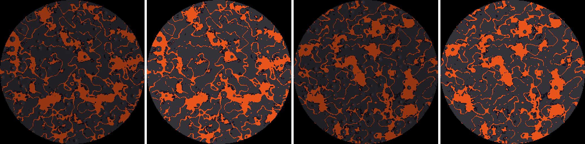

# The sun as a real world (a volcano grid on the sun's path)

**Status:** proposal, written 2026-11-13 (WORK_QUEUE item 42). Built on the moon's systems
([MOON_WORLD.md](./MOON_WORLD.md)): grids as data, `GridFrame`, the far-body bake, the celestial
model, the shared travel. **S-1, S-2 and S-3 built** (this slice; native tests, the sky's disc not yet
seen on a GPU). Not architecture until an ADR adopts it (with the moon's).

## 1. Brief and the owner's answers (2026-11-12)

> "Add this feature to the queue, the sun is an actual world like the moon. Follow similar concepts
> as the moon. The sun is a volcano world. Constant flowing lava, oceans of lava."

- **"The sun's doesn't really light the earth world or moon world, just conceptually."** The sky's
  sunlight stays today's light model; the sun world's lava lights nothing on other grids.
- **"Players can land there."**
- **"Lava has the same function on the sun as the earth world."** (the same damage, burn, flow and
  cooling rules, VOLCANOES.md)
- **"Its gravity will be the same as earth world for now."** (`gravityScale` 1)

## 2. S-1: the sun as a grid on the sun's path [built]

`shared/worldgen/grids.json` gains `dwell:sun`:

| Field | Value | Why |
|---|---|---|
| `frame` | `sunPath` (new kind) | it sits on the sky's sun path |
| `radiusM` | 25 000 | half the home disc's radius (the moon is a quarter); the agent's choice, one number in data |
| `seedSalt` | `"SUN!"` as a u32 | every world its own sun |
| `gravityScale` | 1 | the owner's answer |
| `captureM` | 60 000 | past its radius, as the moon's |
| `farM` | 300 000 | drawn from its bake beyond |
| `surfaceM` | 420 | over its highest cone |

**The frame** (`dwell_look::celestial`): `Celestial::sun_position` is today's sun direction ×
`daynight.json` `sun.distanceM` (954.7 km: the grid's 25 km at the sky disc's 1.5°, checked to 1% by
`daynight.mjs` `checkSunDistance`, as `moonOrbit.distanceM` keeps the moon's); `sun_axes` turns its
face A toward home (y at the home disc's centre, x along the sun's path). `dwell-sim` `grid_frame_at`
places `sunPath` grids from them, with velocity and spin by the same central difference as the moon's.
So **the sky's sun disc is the sun world**: the same size (1.5°), on the same path; its glow and
sunlight are unchanged.

The sun goes round once a day (20 minutes, uneven: 800 s of day, 400 s of night), so at 955 km it moves
~3.7 km/s by day and ~7.5 km/s by night, against the moon's ~1 km/s.

## 3. S-2: the `volcanic` generator [built]

`dwell-worldgen` `volcanic.rs` (`VolcanicTerrain`), all from the grid's `generator` data, face-local,
each face from its own seed stream:

- **Ground:** `datumM` + fbm `plains` + broad fbm `basins`, never under `minM`.
- **Lava oceans:** ground under `lava.seaM` is an ocean floor, lava (`lava.fluid`, `dwell:lava`, the
  block VOLCANOES.md's lava fields write) up to that level.
- **Rifts and lava rivers:** ridged noise's zero lines carved `rifts.depthM` deep across `width` of the
  noise; the bottom `fill` of the depth holds lava, its surface following the land (rivers run downhill).
- **Cones and crater lakes:** one candidate a jittered `cones.cellM` cell (`chance`), radius and height
  in ranges, the flank `(1 − d/R)^profile` over the ground at its centre; a summit crater (`craterRatio`
  × R, `craterDepthM`) holding a lava lake `lakeBelowRimM` under its rim.
- **Crusts:** the ground is `crust` (`dwell:basalt`); a dry column within `shore.bandM` over the lava it
  borders is `shore.block` (`dwell:obsidian`, the quench glass).
- **Chunks:** `VolcanicTerrain::generate` fills a grid chunk through `FaceFrame` (face B's flipped): the
  crust up to the ground, lava up to its level.

The ramp rule over every terrain block (`shared/worldgen/gen.mjs` `surfaceBlocks`) reads the sun's
`crust` and `shore.block`; the lava is a `fluid`, not a terrain block.

Tests (`crates/dwell-worldgen/tests/sun.rs`, both faces): the data's grid and its validation messages;
deterministic per seed, different between seeds and faces; oceans (≥ 5% of the disc), rivers over the
sea in the rifts, crater lakes in ≥ 80% of the cones, basalt and obsidian, heights in the build
volume; the rules are the data (a higher sea floods more; no sea, rifts or cones: no lava); a chunk's
crust, lava and air rows; the bake's lava and darker crusts.

## 4. S-3: the far-body bake and the sky's sun [built; the look on a GPU outstanding]

The generic `bake_far` over `VolcanicTerrain` (`FarSource`): heights are the lava's flat surface where
molten, else the ground; the albedo each block's `color` (lava, basalt, obsidian). 256² a face, ~60 ms
natively (release). Preview, seed 0 (face A lit, its albedo, face B lit, its albedo;
`cargo run --release -p dwell-worldgen --example sun_bake -- 0 <dir>`):

**Drawn** (`dwell-client` `render/moon.rs`): the client bakes the sun's face A at the join
(`sun_bake_for`) beside the moon's and writes its albedo (over its brightest: lava 1) into the moon's
storage buffer after the moon's room (`SUN_BASE`), so no binding is added. `sky.wgsl`'s
`dwell_sun_disc` samples it in the disc's frame (x along the sun's path, as the moon's) and shades its
core by `daynight.json` `sun.surface` (0.45): the lava bright, the crusts darker. The disc's size,
horizon swell, limb darkening, bloom, glow and the sunlight are untouched; with no bake
(`dwell_sun_ground` 1) the sun is today's. The CPU adapter draws it too (one lookup).

Not yet: the look checked on a GPU (cloud sessions have none), relief or a crescent (the sun is its own
light, so its baked normals aren't used).

## 5. Travel by the moon's rules [built natively]

The sun is a grid with its own generator, so everything the moon's travel built takes it by data:
`grid_generator` (its chunks, all-air test off its slab), the server's `Grids` (a space, streaming and
saves per grid, the `grid.frames` wire with its index, 2), the client's `TravelMap` (capture, release
and far flight in the predictor), gravity per grid (1). Tests (`crates/dwell-sim/tests/sun_travel.rs`):
the frame's centre toward the sun's direction at the disc's size, face A toward home, moving with the
path; the client's `TravelMap` holds it; a flier is captured into its space and released home with the
world position (≤ 1 cm) and velocity (≤ 1 cm/s) kept.

**What doesn't generalise yet** (by data alone):

- **The sky on the sun:** the client turns home's sky into the grid's frame (`grid_view.rs`
  `day_on_grid`) and hides only the moon's disc while on the moon; on the sun the sun's own disc and
  sunlight would still be drawn from its direction. Its sky is a later slice (out of scope here).
- **Older clients on the line: gated, built** (orchestrator, 2026-11-13: "gate the sun's travel on the
  client … have the server never capture a client that doesn't declare it into the sun's grid (it flies
  on as before, the sun stays a far body for it)"). A grid's optional `capability` in grids.json (the sun's
  `grid.sun`, a capability of `shared/protocol/capabilities.json`, validated): the server captures a
  session into that grid only when it said the capability (`Grids::capturing`), and counts the grid's
  slab in its far flight only then (`Grids::far_speed`), so an older client's own prediction (two grids)
  stays right; the client's `TravelMap` holds only the grids its session opens (`TravelMap::open_to`,
  `Game::set_grid_capabilities`), so a newer client never predicts a capture by an older server. No new
  line. Tested (`sun_travel.rs` `only_a_client_saying_grid_sun_is_captured_by_the_sun`: a `grid.frames`-only
  client held inside the capture sphere stays home, gets no sun chunk or sun grid id; this build's is
  captured; red without the server's filter).
- **Capture speed:** the sun moves 3.7–7.5 km/s, so a flier is captured with that relative speed; far
  flight (≤ 20 km/s) steers it in the sun's frame within seconds, as at the moon's ~1 km/s.
- **Away players' systems** (the moon's §7.2 list): lava damage is the server's lava fields', which
  aren't placed on other grids, so standing in the sun's generated lava does no harm yet.

## 6. Not in this slice (later)

- **Constant lava flow on the sun** ("Constant flowing lava"): VOLCANOES.md's lava fields placed on the
  sun's rivers and lakes (vents as data), kept molten by the world's heat, with the earth's damage, burn
  and cooling rules ("Lava has the same function on the sun as the earth world").
- **Its sky:** owner, 2026-11-13: "Sun and moon should be space, the same as night sky. Could perhaps
  just make space a more general skybox and have 'day' be a closer atmosphere skybox so it can fade out as
  you leave earth." The general sky is the moon session's work (M-5 branch); the sun then only declares in
  its grid data that it has no atmosphere (no such field in grids.json yet when this slice merged main).
- **Spawns** on the sun's faces (`?spawn=sun`, `sun-b`), as the moon's M-8.
- The sun's LOD terrain inside `farM` (with the moon's M-5).

## 7. Compatibility

- Adding the grid and its blocks changes no home terrain and no saved world (the sun's chunks go to the
  optional `grid_chunks` table, as the moon's).
- The sky change is a look.
- Travel to the sun puts grid index 2 on the `grid.frames` wire only for clients that say `grid.sun`
  (§5), so the slice is additive on the current line.
